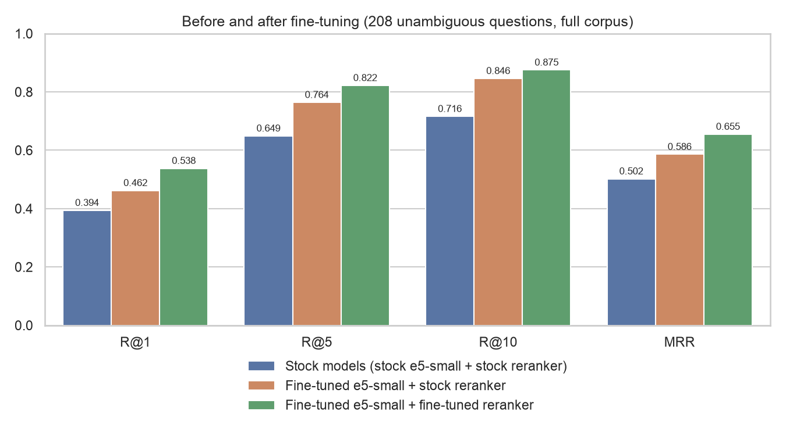
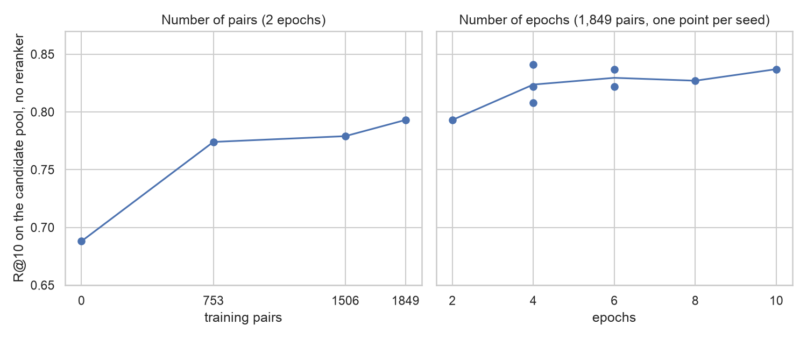
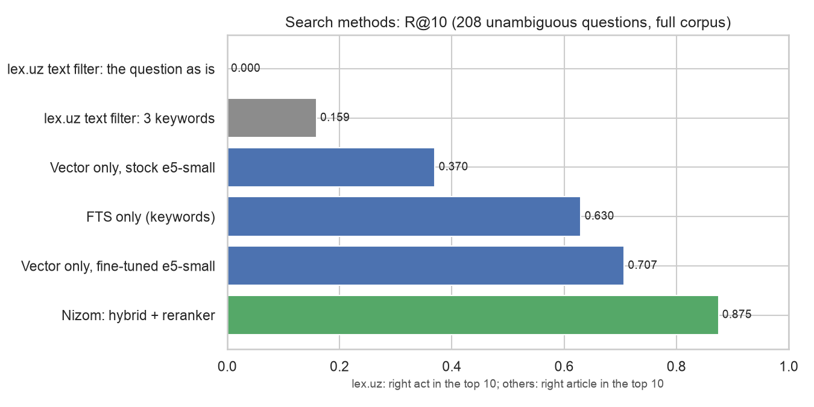
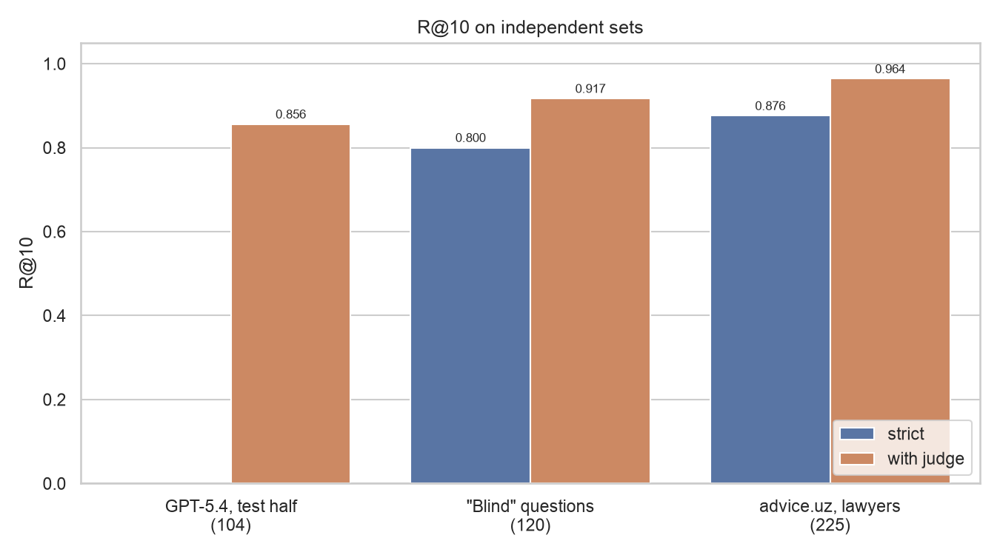

# Nizom

[O'zbekcha](README.md) | English

A remote MCP server for the legislation of Uzbekistan. An AI assistant (Claude, ChatGPT, Cursor
and others) finds the article that answers a user's question in the current text on
[lex.uz](https://lex.uz), reads it, and links to that exact article in its answer.

- **Endpoint:** `https://nizom.org/mcp` (Streamable HTTP, sign in with Google)
- **Price:** free. 30 searches and 200 other calls per day, 10 per minute.
- **Corpus:** 15,810 acts in force (Uzbek, Latin script): the Constitution, codes, laws,
  presidential decrees and resolutions, Cabinet of Ministers resolutions, ministry orders.
  491,947 chunks, refreshed from lex.uz every night.

## Connecting

| Client | How |
|---|---|
| claude.ai / Claude Desktop | Settings → Connectors → Add custom connector → `https://nizom.org/mcp` |
| ChatGPT | Settings → Apps & Connectors → Advanced settings → Developer mode → new connector |
| Claude Code | `claude mcp add --transport http nizom https://nizom.org/mcp`, then `/mcp` |
| Cursor and others | add the URL as a "remote MCP server (Streamable HTTP)" |

## Tools

| Tool | What it does |
|---|---|
| `search_law` | Hybrid search over the question plus formal rephrasings written by the AI (`alt_queries`); returns the 8 best articles |
| `get_article` | Full text of one article or clause, its status and latest amendments |
| `get_document` | Requisites and table of contents of an act |
| `get_section` | Text of a chapter or section |
| `find_document` | Find an act by name, number or kind |
| `list_codes` | The codes currently in force |

Every result carries a lex.uz link. A search result is about 1,100 tokens; a page never exceeds
about 2,500.

## How search works

```
question + alt_queries ─┬─ FTS (PostgreSQL): normalization → lemma → stemming → IDF weighting ─┐
                        └─ vector: fine-tuned e5-small (ONNX int8) → pgvector HNSW ─────────────┴─ RRF
   → top 30 articles → fine-tuned cross-encoder (reranker) → 8 articles
```

- There is no off-the-shelf stemmer for Uzbek, so we wrote one (case → possessive → plural
  suffixes). It is backed by a lemma table of 9,081 nouns generated with uzmorph.
- The embedding model `multilingual-e5-small` and the reranker `mmarco-mMiniLMv2-L12` were
  fine-tuned on Uzbek legal "question → article" pairs (see below).
- The server has no GPU (one Hetzner box, 2 cores): a search takes 2–3 s, most of it in the reranker.

## Results

Metric: **Recall@10**, the share of questions whose correct article is among the first 10
results. R@1 means the correct article is ranked first. All numbers are measured on the full
corpus, with the production code, on questions rephrased by an AI (`alt_queries`), the way a
real client calls the tool. Full log (in Uzbek): [docs/stage2-experiments.md](docs/stage2-experiments.md).

### Before and after fine-tuning

Set: 208 unambiguous questions written by GPT-5.4 from the whole corpus (`eval/questions_llm_full.yaml`).



All three runs in the chart use a reranker. The last one also includes lemmas and the new fusion settings (last row of the table).

| Step | R@1 | R@5 | R@10 | MRR |
|---|---:|---:|---:|---:|
| Baseline: stock e5-small, no reranker | 0.245 | 0.562 | 0.668 | 0.375 |
| + stock reranker (top 20) | 0.394 | 0.649 | 0.716 | 0.502 |
| Fine-tuned e5-small, no reranker | 0.389 | 0.697 | 0.793 | 0.515 |
| Fine-tuned e5-small + stock reranker | 0.462 | 0.764 | 0.846 | 0.586 |
| **+ lemmas, new fusion, fine-tuned reranker (top 30)** | **0.538** | **0.822** | **0.875** | **0.655** |

End to end: R@10 0.668 → 0.875, and R@1 more than doubled (0.245 → 0.538).

The clean effect of fine-tuning shows in vector-only search: R@10 0.370 → 0.707 (full corpus).
Fine-tuning the reranker alone (offline, top 30 articles, int8): R@1 0.50 → 0.54, R@10 0.851 → 0.889.

**Training.** 1,849 "question → article" pairs (written by GPT-5.4, checked against quoted text;
documents used for evaluation were excluded). In-batch negatives, 6 epochs, lr 3e-5. The reranker
was trained on hard negatives mined with the fine-tuned e5 (groups of 1 positive + 15 negatives).
On a rented GPU (RunPod) one training run takes about 40 s and re-embedding the whole corpus
about 5.5 minutes. All GPU experiments together cost about $3.



Observations:
- The big jump comes from the first 753 pairs (0.688 → 0.774). Doubling the data after that barely
  moved the score (0.774 → 0.793): at this size, data is not the bottleneck.
- Longer training helped: 2 epochs 0.793, 4–10 epochs 0.81–0.84, saturating after 4.
- Seed noise is large: the same settings give R@10 0.808–0.841, so every decision was checked
  across several runs.
- int8 quantization cost nothing (0.837 vs 0.837 on the pool), so the server runs int8.

### Compared with other search methods

Same 208 questions, full corpus:



| Method | R@1 | R@10 |
|---|---:|---:|
| lex.uz text filter: the question as is | 0.000 | 0.000 |
| lex.uz text filter: formal phrase written by the AI | 0.005 | 0.019 |
| lex.uz text filter: first 2 words of the phrase | 0.034 | 0.120 |
| lex.uz text filter: first 3 words of the phrase | 0.038 | 0.159 |
| Vector only, stock e5-small | 0.101 | 0.370 |
| FTS only (keywords, with Uzbek stemming and lemmas) | 0.264 | 0.630 |
| Vector only, fine-tuned e5-small | 0.274 | 0.707 |
| **Nizom: hybrid + reranker** | **0.538** | **0.875** |

- "lex.uz text filter" is the "Matndagi so'z yoki jumla" (word or phrase in the text) field on
  lex.uz's ["National legislation" listing](https://lex.uz/uz/search/nat?lang=4) ("exact match"
  unchecked, acts in force only). The site has no separate general search box; searching by text
  goes through this filter.
- The filter finds acts that contain every word of the query and sorts them by date (newest
  first), not by relevance. It returns acts, not articles, so it gets an easier test: the right act
  anywhere in the first 10 results. Nizom has to put the right article in the top 10. Queries were
  cut to 100 characters (the lex.uz limit) and apostrophes converted to the lex.uz spelling (oʻ, gʻ, ʼ).
- With the question text lex.uz returned nothing for all 208 questions ("no documents found"); with
  the formal phrase, for 96 % of them. With 2–3 keywords there is almost always a result, but since
  it is not ranked by relevance, the right act rarely lands in the first 10. It is a
  word filter: handy when you know an act's title or number, but not designed to understand a plain
  question and find the answer. The keywords were picked by a simple rule; a person choosing them
  carefully could do better.
- Script: [scripts/lexuz_search_eval.py](scripts/lexuz_search_eval.py), results:
  `eval/results/2026-11-24-lexuz-search.jsonl`.
- Keyword search and vector search each stop at 0.63–0.71 on their own. Fused and reranked, they
  reach 0.875.

### Uzbek stemmer and lemmas

FTS maps word forms to one term: "soliqqa", "soliqlar", "soligʻi" (tax: to the tax, taxes, its tax)
→ one term. Three settings were measured: no stemming (words only lower-cased), the stemmer
alone (suffixes stripped), stemmer + lemmas (production). Same 208 questions, full corpus, a database
restored from last night's backup:

| R@10 | No stemming | Stemmer | Stemmer + lemmas |
|---|---:|---:|---:|
| FTS only | 0.428 | 0.615 | 0.630 |
| Hybrid, no reranker | 0.760 | 0.812 | 0.817 |
| Hybrid + reranker (Nizom) | 0.870 | 0.885 | 0.875 |

- **The stemmer makes FTS much stronger:** R@10 0.428 → 0.615, R@1 0.139 → 0.250. Per question: the
  answer entered the top 10 for 53 questions and left it for 14.
- **Hybrid search without a reranker** gains too: 0.760 → 0.812 (+14, −3 questions).
- **With the reranker the gap disappears** (0.870–0.885, a few questions). Vector search and the
  reranker handle word forms themselves, so they make up for what FTS misses.
- **Lemmas add almost nothing on top of the stemmer** (FTS 0.615 → 0.630, +6, −3 questions, within
  noise). They were kept because they nudge R@1 and R@5 up.
- Script: [scripts/fts_ablation.py](scripts/fts_ablation.py), results:
  `eval/results/2026-11-24-fts-ablation-{none,stem,lemma}.json`.

### Independent checks

The settings above were tuned on those 208 questions, so the number could be optimistic. It was
re-measured on three more sets:



| Set | Questions | R@1 | R@10, strict | R@10, with judge |
|---|---:|---:|---:|---:|
| GPT-5.4 questions, held-out `test` half (never used for tuning) | 104 | 0.529 | — | 0.856 |
| "Blind" questions: written without seeing any article, answers found in the corpus by hand | 120 | 0.408 | 0.800 | 0.917 |
| [advice.uz](https://advice.uz): questions asked by people and answered by lawyers | 225 | 0.493 | 0.876 | 0.964 |

- **Strict** counts only the answers labeled in advance. **With judge** also counts other correct
  articles in the top 10 (found by an LLM judge, each checked against the quoted text). The true
  value lies between the two.
- All three sets tell the same story. On real questions (advice.uz) search does no worse than on
  LLM-written ones.

### Weak spots

- **Vague questions.** Questions without context ("How long is a contract signed for?") score much
  lower: on advice.uz R@10 is 0.876 for clear questions and 0.591 for vague ones. There the
  assistant should ask the user to clarify.
- **Domains.** On the "blind" set (strict R@10) housing (0.44), business and liability (0.50) are
  the weakest. Pensions, health, inheritance and military service score 1.00. Each domain has only
  8–15 questions, so these numbers are rough.
- **What the corpus lacks.** Only acts in force, in Latin script. No court practice, no commentary,
  and the very latest acts may not be in yet.

### End-to-end test with Claude Code

Claude Code was given only Nizom (no web search) and 10 questions:

| Criterion | Result |
|---|---|
| Expected article read with `get_article` | 10/10 |
| Links in the answer lead to a real article | 34/35 |
| "Not legal advice" disclaimer | 10/10 |
| Tool calls per question | 3–8 (5 on average) |

## Speed and resources

The server is small: 2 vCPUs, 3.7 GB RAM, no GPU. So the heavy work was done once, off the server,
and the server only uses the result:

| Job | Where | Time |
|---|---|---|
| Embed the whole corpus (492k chunks, fp32) | rented GPU (RTX PRO 6000) | ≈5.5 min (10.7 h on an office CPU) |
| Fine-tune e5-small (1,849 pairs, 2 epochs) | rented GPU (RTX 3090) | ≈40 s (68 min on CPU) |
| Fine-tune the reranker | rented GPU (RTX 5090) | ≈1 min |
| Embed the question and rerank | server, CPU, ONNX int8 | every request |
| New acts from the nightly update | server, CPU, ONNX int8 | nightly, changed acts only |

Document vectors were computed in fp32 on the GPU and written straight into the database; questions
are embedded on the server with the int8 model. This mix scores the same as all-fp32 (hybrid R@10
0.837 vs 0.837 on the pool).

One search takes 2–3 s on the server:
- FTS 0.04–0.2 s;
- most of the time is the reranker: ≈1.4 s for 30 articles. Scoring articles in length-sorted
  batches cut this from ≈2.2 s to 1.4 s.

## Stack

Python 3.12, [MCP Python SDK](https://github.com/modelcontextprotocol/python-sdk) (FastMCP),
PostgreSQL 16 + pgvector (halfvec, HNSW), onnxruntime (int8), OAuth 2.1 + Google.
Hosting: a single Hetzner server, systemd + nginx, Cloudflare. Nightly updates, backups and
Telegram alerts. No Docker.

## Development

```sh
uv sync
uv run nizom --help
uv run ruff format . && uv run ruff check . && uv run pytest
```

Tests never touch the network: they use trimmed real pages from `tests/fixtures/`.
Local server: create `.env` from `.env.example`, then `uv run nizom serve --no-auth`.
The fine-tuned model files are not in the repository.

Docs (in Uzbek): [PLAN.md](PLAN.md) (decisions and stages), [docs/](docs/) (design and results of
each stage, research on lex.uz).

## Legal

Official documents (laws, resolutions) are not subject to copyright (Law of Uzbekistan "On
Copyright and Related Rights", [Article 8](https://lex.uz/docs/-1022944#-1023047)). The service is
free and links to lex.uz in every answer. This is an unofficial project, not affiliated with
lex.uz, the "Adolat" National Legal Information Center or any government body. Answers are
general information, not legal advice.

## License

Code: [MIT](LICENSE).
