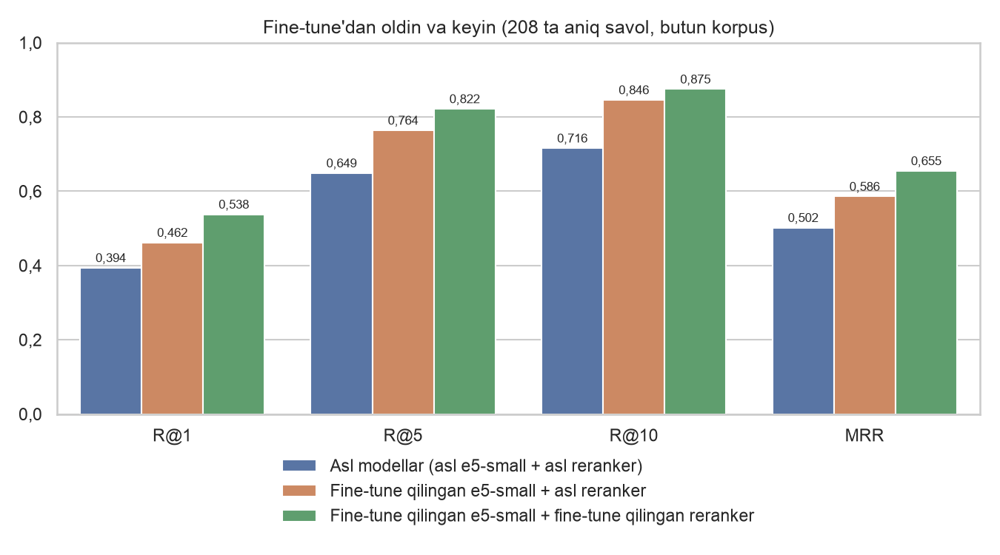
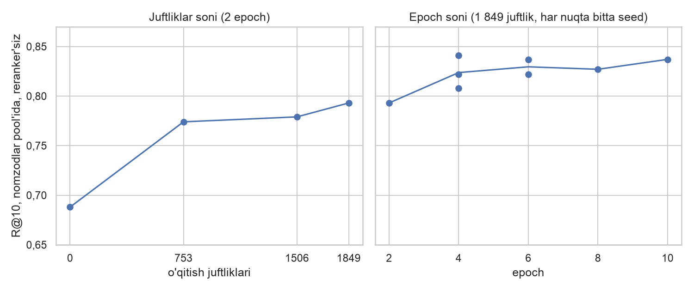
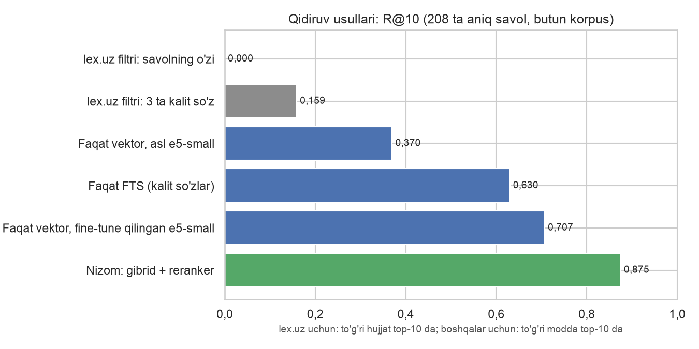
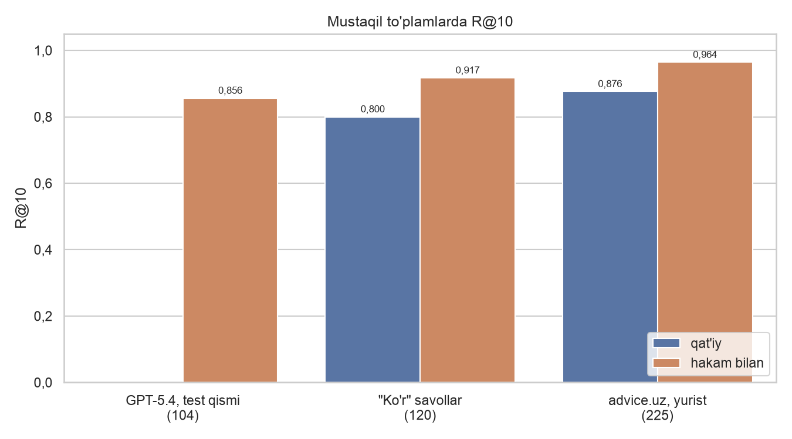

# Nizom

O'zbekiston qonunchiligi bo'yicha remote MCP server. AI yordamchi (Claude, ChatGPT, Cursor va
boshqalar) foydalanuvchi savoliga mos moddani [lex.uz](https://lex.uz)dagi amaldagi matndan
topadi, o'qiydi va javobda moddaga aniq havola beradi.

- **Manzil:** `https://nizom.org/mcp` (Streamable HTTP, kirish Google orqali)
- **Narx:** bepul. Kuniga 30 ta qidiruv va 200 ta boshqa so'rov, daqiqasiga 10 ta.
- **Korpus:** 15 810 ta amaldagi hujjat (o'zbek tili, lotin yozuvi): Konstitutsiya, kodekslar,
  qonunlar, Prezident farmon va qarorlari, Vazirlar Mahkamasi qarorlari, idoralar buyruqlari.
  491 947 ta bo'lak, har kecha lex.uz'dan yangilanadi.

## Ulanish

| Mijoz | Qanday |
|---|---|
| claude.ai / Claude Desktop | Settings → Connectors → Add custom connector → `https://nizom.org/mcp` |
| ChatGPT | Settings → Apps & Connectors → Advanced settings → Developer mode → yangi konnektor |
| Claude Code | `claude mcp add --transport http nizom https://nizom.org/mcp`, keyin `/mcp` |
| Cursor va boshqalar | "remote MCP server (Streamable HTTP)" sifatida shu manzil |

## Tool'lar

| Tool | Vazifasi |
|---|---|
| `search_law` | Gibrid qidiruv: savol va AI yozgan rasmiy iboralar (`alt_queries`) bo'yicha eng mos 8 ta modda |
| `get_article` | Bitta modda yoki bandning to'liq matni, holati va oxirgi o'zgarishlari |
| `get_document` | Hujjat rekvizitlari va mundarijasi |
| `get_section` | Bob yoki bo'limning matni |
| `find_document` | Hujjatni nomi, raqami yoki turi bo'yicha topish |
| `list_codes` | Amaldagi kodekslar ro'yxati |

Har bir javobda lex.uz havolasi bor. Qidiruv natijasi ≈1 100 token, sahifa ≈2 500 tokendan oshmaydi.

## Qidiruv qanday ishlaydi

```
savol + alt_queries ─┬─ FTS (PostgreSQL): normalizatsiya → lemma → stemming → IDF og'irligi ─┐
                     └─ vektor: fine-tune qilingan e5-small (ONNX int8) → pgvector HNSW ──────┴─ RRF
   → top 30 modda → fine-tune qilingan cross-encoder (reranker) → 8 ta modda
```

- O'zbek tili uchun tayyor stemmer yo'q, shuning uchun o'zimiz yozdik (kelishik → egalik →
  ko'plik). Unga uzmorph'dan olingan 9 081 ta otning lemma jadvali qo'shildi.
- Embedding modeli `multilingual-e5-small` va reranker `mmarco-mMiniLMv2-L12` o'zbekcha yuridik
  "savol → modda" juftliklarida qo'shimcha o'qitildi (pastda).
- Server GPU'siz ishlaydi (Hetzner, 2 yadro): bitta qidiruv 2–3 s, asosiy vaqt reranker'da.

## Natijalar

Metrika: **Recall@10**, ya'ni to'g'ri modda birinchi 10 ta natija ichida bo'lgan savollar ulushi.
R@1 — to'g'ri modda birinchi o'rinda. O'lchovlar butun korpusda, xizmatdagi kod bilan, AI qayta
yozgan savollar (`alt_queries`) bilan o'tkazildi. Batafsil: [docs/stage2-experiments.md](docs/stage2-experiments.md).

### Fine-tune'dan oldin va keyin

To'plam: GPT-5.4 butun korpusdan yozgan 208 ta aniq savol (`eval/questions_llm_full.yaml`).



Grafikada uchala variant ham reranker bilan. Oxirgisida lemma va yangi birlashtirish sozlamalari ham bor (jadvaldagi oxirgi qator).

| Qadam | R@1 | R@5 | R@10 | MRR |
|---|---:|---:|---:|---:|
| Boshlang'ich: asl e5-small, reranker'siz | 0,245 | 0,562 | 0,668 | 0,375 |
| + asl reranker (top 20) | 0,394 | 0,649 | 0,716 | 0,502 |
| Fine-tune qilingan e5-small, reranker'siz | 0,389 | 0,697 | 0,793 | 0,515 |
| Fine-tune qilingan e5-small + asl reranker | 0,462 | 0,764 | 0,846 | 0,586 |
| **+ lemma, yangi birlashtirish, fine-tune qilingan reranker (top 30)** | **0,538** | **0,822** | **0,875** | **0,655** |

Butun yo'l: R@10 0,668 → 0,875, R@1 ikki barobardan ko'p (0,245 → 0,538).

Fine-tune'ning sof ta'siri faqat vektor qidiruvida ko'rinadi: R@10 0,370 → 0,707 (butun korpus).
Reranker'ning o'zini fine-tune qilish (oflayn, top 30 modda, int8): R@1 0,50 → 0,54, R@10 0,851 → 0,889.

**O'qitish.** 1 849 ta "savol → modda" juftligi (GPT-5.4 yozgan, iqtibos bilan tekshirilgan;
baholash hujjatlari chiqarib tashlangan). In-batch negatives, 6 epoch, lr 3e-5. Reranker esa
fine-tune qilingan e5 topgan hard negative'lar bilan o'qitildi (guruhda 1 to'g'ri + 15 noto'g'ri).
Ijaradagi GPU'da (RunPod) bitta o'qitish ≈40 s, butun korpusni qayta embedding qilish ≈5,5 daqiqa.
Barcha GPU tajribalari ≈3 $ turdi.



Kuzatuvlar:
- Eng katta sakrash birinchi 753 juftlikda (0,688 → 0,774). Undan keyin juftliklar ikki barobar
  ko'paysa ham natija deyarli o'zgarmadi (0,774 → 0,793): bu hajmda ma'lumot asosiy cheklov emas.
- Uzunroq o'qitish foyda berdi: 2 epoch 0,793, 4–10 epoch 0,81–0,84. 4 epoch'dan keyin to'yinadi.
- Seed shovqini katta: bir xil sozlamada R@10 0,808–0,841. Har bir qaror bir nechta run bilan tekshirildi.
- int8 kvantlash sifatni pasaytirmadi (pool'da 0,837 va 0,837), shuning uchun serverga int8 qo'yildi.

### Boshqa qidiruv usullari bilan solishtirish

Bir xil 208 savol, butun korpus:



| Usul | R@1 | R@10 |
|---|---:|---:|
| lex.uz filtri: savolning o'zi | 0,000 | 0,000 |
| lex.uz filtri: AI yozgan rasmiy ibora | 0,005 | 0,019 |
| lex.uz filtri: iboraning birinchi 2 so'zi | 0,034 | 0,120 |
| lex.uz filtri: iboraning birinchi 3 so'zi | 0,038 | 0,159 |
| Faqat vektor, asl e5-small | 0,101 | 0,370 |
| Faqat FTS (kalit so'zlar, o'zbekcha stemming va lemma bilan) | 0,264 | 0,630 |
| Faqat vektor, fine-tune qilingan e5-small | 0,274 | 0,707 |
| **Nizom: gibrid + reranker** | **0,538** | **0,875** |

- "lex.uz filtri" — lex.uz'dagi hujjatlar ro'yxatining
  ["Milliy qonunchilik" sahifasidagi](https://lex.uz/uz/search/nat?lang=4) "Matndagi so'z yoki
  jumla" maydoni ("Aniq mos kelishi" belgilanmagan, faqat amaldagi hujjatlar). Saytda alohida
  umumiy qidiruv oynasi yo'q, matn bo'yicha qidirish shu filtr orqali.
- Bu filtr so'rovdagi hamma so'z bor hujjatlarni topadi va ularni moslik bo'yicha emas,
  sana bo'yicha (eng yangisi birinchi) tartiblaydi. U modda emas, hujjat qaytaradi, shuning uchun
  uning uchun yengilroq mezon olindi: to'g'ri hujjat birinchi 10 natija ichida bo'lsa yetarli.
  Nizom uchun esa to'g'ri modda top-10 da bo'lishi kerak. So'rovlar 100 belgigacha qisqartirildi
  (lex.uz cheklovi), apostroflar lex.uz yozuviga (oʻ, gʻ, ʼ) keltirildi.
- Savol matni bilan lex.uz 208 savolning birortasida ham natija qaytarmadi ("hujjat topilmadi"),
  rasmiy ibora bilan 96 % hollarda shunday. 2–3 ta kalit so'z bilan natija deyarli doim bor, lekin
  moslik bo'yicha saralanmagani uchun kerakli hujjat birinchi 10 tasiga kamdan-kam tushadi. Bu
  so'zlar bo'yicha filtr: hujjat nomi yoki raqami ma'lum bo'lganda qulay, lekin oddiy
  savolni tushunib, javobni topib berish uchun mo'ljallanmagan. Kalit so'zlar oddiy qoida bilan
  olindi: ularni qo'lda yaxshiroq tanlagan odam yuqoriroq natija olishi mumkin.
- Skript: [scripts/lexuz_search_eval.py](scripts/lexuz_search_eval.py), natija:
  `eval/results/2026-11-24-lexuz-search.jsonl`.
- Kalit so'z qidiruvi ham, vektor qidiruvi ham alohida 0,63–0,71 da qoladi. Ikkalasini birlashtirib,
  reranker bilan qayta saralaganda 0,875 ga chiqadi.

### O'zbekcha stemmer va lemma

FTS so'zlarni bir xil shaklga keltiradi: "soliqqa", "soliqlar", "soligʻi" → bitta so'z. Uch xil
holatda o'lchandi: stemmer'siz (so'z faqat kichik harfga o'tkaziladi), faqat stemmer (qo'shimchalar
kesiladi), stemmer + lemma (xizmatdagi holat). Bir xil 208 savol, butun korpus, kechagi zaxira
nusxadan tiklangan baza:

| R@10 | Stemmer'siz | Stemmer | Stemmer + lemma |
|---|---:|---:|---:|
| Faqat FTS | 0,428 | 0,615 | 0,630 |
| Gibrid, reranker'siz | 0,760 | 0,812 | 0,817 |
| Gibrid + reranker (Nizom) | 0,870 | 0,885 | 0,875 |

- **Stemmer FTS'ni ancha kuchaytirdi:** R@10 0,428 → 0,615, R@1 0,139 → 0,250. Savollar
  kesimida: 53 ta savolda javob top-10 ga chiqdi, 14 tasida chiqmay qoldi.
- **Reranker'siz gibrid qidiruvda** ham foyda bor: 0,760 → 0,812 (+14, −3 savol).
- **Reranker bilan farq yo'qoladi** (0,870–0,885, bir necha savol). Vektor qidiruvi va reranker
  so'z shaklini o'zi tushunadi, shuning uchun so'z shakli FTS ichida xato bo'lsa ham ular
  to'g'rilab qo'yadi.
- **Lemma stemmer ustiga deyarli hech narsa qo'shmadi** (FTS 0,615 → 0,630, +6, −3 savol,
  shovqin chegarasida). Lemma R@1 va R@5 ni biroz ko'targani uchun qoldirildi.
- Skript: [scripts/fts_ablation.py](scripts/fts_ablation.py), natijalar:
  `eval/results/2026-11-24-fts-ablation-{none,stem,lemma}.json`.

### Mustaqil tekshiruv

Sozlamalar yuqoridagi 208 savolda tanlangani uchun natija optimistik bo'lishi mumkin edi. Shuning
uchun yana uchta to'plamda o'lchandi:



| To'plam | Savol | R@1 | R@10, qat'iy | R@10, hakam bilan |
|---|---:|---:|---:|---:|
| GPT-5.4 savollari, `test` qismi (sozlashda ishlatilmagan) | 104 | 0,529 | — | 0,856 |
| "Ko'r" savollar: moddani ko'rmay yozilgan, javoblar korpusdan qo'lda topilgan | 120 | 0,408 | 0,800 | 0,917 |
| [advice.uz](https://advice.uz): odamlar bergan, yurist javob bergan savollar | 225 | 0,493 | 0,876 | 0,964 |

- **Qat'iy** — faqat oldindan belgilangan javoblar hisoblanadi. **Hakam bilan** — top-10 dagi
  boshqa to'g'ri moddalar ham hisoblanadi (LLM hakam topadi, har biri iqtibos bilan tekshirilgan).
  Haqiqiy qiymat shu ikki raqam orasida.
- Uchala to'plam bir xil manzarani beradi. Haqiqiy savollarda (advice.uz) natija LLM
  savollaridagidan past emas.

### Zaif joylar

- **Noaniq savollar.** Kontekstsiz savollarda ("Shartnoma qancha muddatga tuziladi?") natija ancha
  past: advice.uz'da aniq savollar R@10 0,876, noaniq savollar 0,591. Bunday holda AI
  foydalanuvchidan aniqlashtirishi kerak.
- **Sohalar.** "Ko'r" savollarda (qat'iy R@10) eng past natija uy-joy (0,44), tadbirkorlik va
  javobgarlik (0,50) sohalarida. Pensiya, sog'liq, meros va harbiy xizmatda 1,00. Har bir sohada
  8–15 savol bor, shuning uchun bu raqamlar taxminiy.
- **Korpusda yo'q narsa.** Faqat amaldagi lotin yozuvidagi hujjatlar bor. Sud amaliyoti, sharhlar
  va eng so'nggi (hali yangilanmagan) hujjatlar yo'q.

### Claude Code bilan uchdan-uchgacha sinov

Claude Code'ga faqat Nizom berildi (veb-qidiruvsiz), 10 ta savol:

| Mezon | Natija |
|---|---|
| Kutilgan modda `get_article` bilan o'qildi | 10/10 |
| Javobdagi havolalar haqiqiy moddaga olib boradi | 34/35 |
| "Yuridik maslahat emas" ogohlantirishi | 10/10 |
| Bitta savolga tool chaqiruvi | 3–8 (o'rtacha 5) |

## Tezlik va resurslar

Server kuchsiz: 2 vCPU, 3,7 GB RAM, GPU yo'q. Shuning uchun og'ir ishlar serverdan tashqarida bir
marta bajarildi, server esa faqat tayyor natijadan foydalanadi:

| Ish | Qayerda | Vaqt |
|---|---|---|
| Butun korpusni embedding qilish (492 ming bo'lak, fp32) | ijaradagi GPU (RTX PRO 6000) | ≈5,5 daqiqa (ofisdagi CPU'da 10,7 soat) |
| e5-small'ni fine-tune qilish (1 849 juftlik, 2 epoch) | ijaradagi GPU (RTX 3090) | ≈40 s (CPU'da 68 daqiqa) |
| Reranker'ni fine-tune qilish | ijaradagi GPU (RTX 5090) | ≈1 daqiqa |
| Savolni embedding qilish va qayta saralash | server, CPU, ONNX int8 | har so'rovda |
| Tungi yangilanishdagi yangi hujjatlar | server, CPU, ONNX int8 | har kecha, faqat o'zgargan hujjatlar |

Hujjat vektorlari GPU'da fp32 bilan hisoblanib, bazaga to'g'ridan-to'g'ri yozildi. Savollar esa
serverda int8 model bilan embedding qilinadi. Bu aralash usul to'liq fp32 bilan bir xil natija
beradi (pool'da hybrid R@10 0,837 va 0,837).

Bitta qidiruv serverda 2–3 s davom etadi:
- FTS 0,04–0,2 s;
- asosiy vaqt reranker'da: 30 ta modda ≈1,4 s. Moddalarni uzunligi bo'yicha guruhlab baholash
  bu vaqtni ≈2,2 s dan 1,4 s ga tushirdi.

## Stek

Python 3.12, [MCP Python SDK](https://github.com/modelcontextprotocol/python-sdk) (FastMCP),
PostgreSQL 16 + pgvector (halfvec, HNSW), onnxruntime (int8), OAuth 2.1 + Google.
Xizmat: bitta Hetzner server, systemd + nginx, Cloudflare. Har kecha yangilash, zaxira nusxa va
Telegram'ga xabar. Docker yo'q.

## Ishlab chiqish

```sh
uv sync
uv run nizom --help
uv run ruff format . && uv run ruff check . && uv run pytest
```

Testlar tarmoqqa chiqmaydi: `tests/fixtures/`dagi qisqartirilgan haqiqiy sahifalar ishlatiladi.
Mahalliy server: `.env.example` asosida `.env`, keyin `uv run nizom serve --no-auth`.
Fine-tune qilingan model fayllari repoga kiritilmagan.

Hujjatlar: [PLAN.md](PLAN.md) (qarorlar va bosqichlar), [docs/](docs/) (har bir bosqich dizayni
va natijasi, lex.uz tadqiqoti).

## Huquqiy holat

Rasmiy hujjatlar (qonunlar, qarorlar) mualliflik huquqi obyekti emas ("Mualliflik huquqi va
turdosh huquqlar to'g'risida"gi Qonun, [8-modda](https://lex.uz/docs/-1022944#-1023047)). Xizmat
bepul va har bir javobda lex.uz'ga havola beradi. Bu norasmiy loyiha: lex.uz, "Adolat" milliy
huquqiy axborot markazi va davlat organlariga aloqasi yo'q. Javoblar umumiy ma'lumot, yuridik
maslahat emas.
